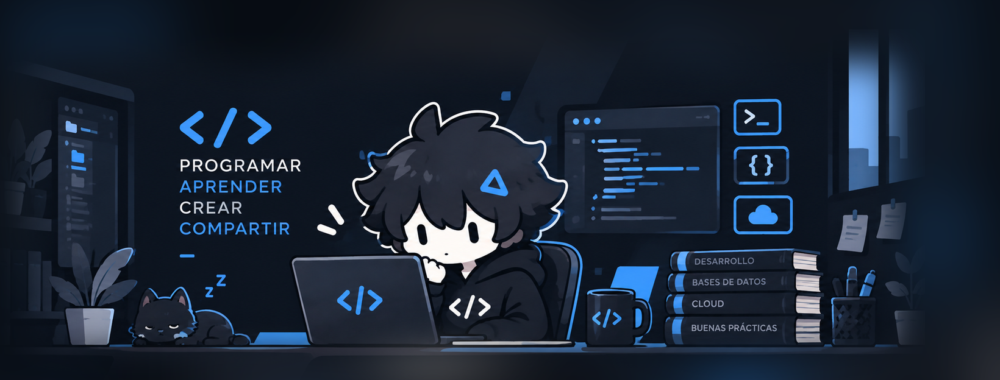
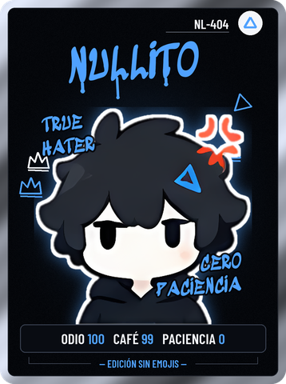
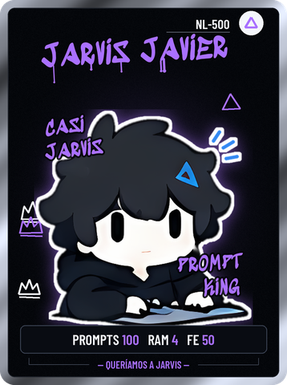
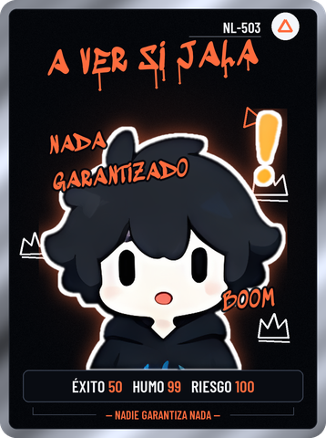

<div align="center">



<a href="https://www.youtube.com/@Nullito-main"></a>

<a href="https://www.youtube.com/@Nullito-main"></a> <a href="https://www.instagram.com/nullitomain/"></a> <a href="https://www.facebook.com/people/Nullito/61595963339452/"></a>

</div>

---

### `$ whoami`

```text
nombre      Nullito
oficio      programador chibi con cero paciencia
hace        videos de programación en YouTube
cree en     leer la documentación (no lo hace)
odia        los emojis, los deploys en viernes y el código de ayer
estado      compilando
```

Desarmo la tecnología para ver qué porquería hay dentro y te explico por qué, en realidad, tenía sentido. El odio es la excusa; la explicación va en serio.

Aquí vive el código de los videos y las herramientas de uso público que sobreviven al deploy.

---

### Las secciones del canal

<table>
  <tr>
    <td align="center" width="25%"></td>
    <td align="center" width="25%"></td>
    <td align="center" width="25%"></td>
    <td align="center" width="25%"></td>
  </tr>
  <tr>
    <td valign="top"><b>Viboreando</b><br><sub>Ingeniería inversa. A ver qué tan mal está hecho esto por dentro.</sub></td>
    <td valign="top"><b>Jarvis Javier</b><br><sub>Inteligencia artificial. Queríamos a Jarvis. Nos salió Javier.</sub></td>
    <td valign="top"><b>Me Choca…</b><br><sub>Fundamentos. Me choca, pero te lo explico.</sub></td>
    <td valign="top"><b>A Ver Si Jala</b><br><sub>Retos y experimentos. Nadie garantiza nada.</sub></td>
  </tr>
</table>

---

### Con qué me peleo

      

---

### Reglas de la casa

```diff
+ cada queja viene con su porqué técnico
+ lo documentado se separa de lo que suponemos
+ si algo se rompe, también se cuenta
- emojis
- deploy en viernes
- "en este tutorial aprenderás..."
```

<div align="center">

<sub>Hecho a puro odio. Si funciona, no lo toques.</sub>

</div>
